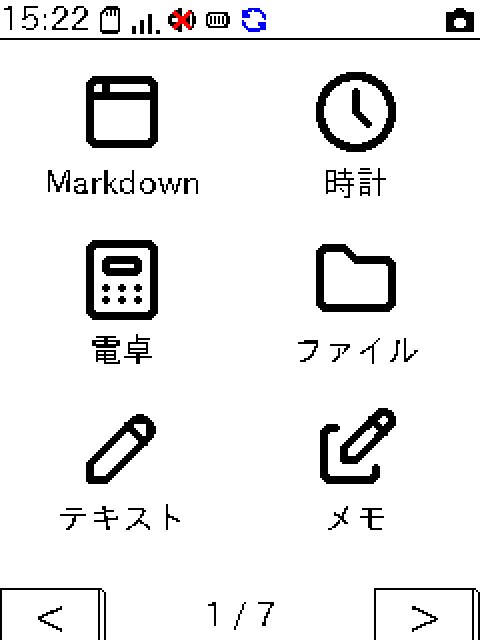

# pico-os

Raspberry Pi Pico 2 W(RP2350)の上で動く、自作のタッチ操作GUI OS。
PlatformIO + Arduino の C++ で書かれ、240x320のTFT液晶とタッチパネルで操作する。
同じソースをPC(SDL2)とブラウザ(WebAssembly)でも動かせる。

<p align="center"></p>

- **ブラウザで試す**: <https://kimu1109.github.io/pico-os/>(Web版本体は `/playground/`)
- **Lua APIの説明**: <https://kimu1109.github.io/pico-os/lua-api/>

## できること

- **自前のGUIフレームワーク** — ウィジェット・シーン・ダイアログ・オンスクリーンキーボード(日本語かな漢字変換つき)。PICO-8風の16色パレットとダークテーマ
- **標準アプリ** — Markdown/Webブラウザ、時計・アラーム・タイマー、電卓、ファイル、テキストエディタ、メモ、カレンダー、TODO、チャット、メール、辞書、読書(青空文庫)、SSH、ミュージック、動画、ゲームボーイエミュレータ など
- **Luaアプリ** — SDカードの `lua/apps/<名前>/main.lua` を置くだけでホーム画面に並ぶ。`pico.*` API(描画・SD・ネットワーク・ゲーム・2.5Dエンジン等)とアプリストア
- **OSの機能** — Wi-Fiの管理(保存済み・固定IP・mDNS・スマホからの設定)、通知、バックグラウンド実行、画面ロック、自動調光とスリープ、スクリーンショット、Wi-Fi経由のファーム更新
- **音** — I2S出力のチップチューン音源・MML・WAV、I2Sマイクでの録音
- **入力** — タッチのほか、物理キーボード(CardKB2・USBシリアル)とWiiクラシックコントローラー
- **開発者向けの道具** — プロファイラ、Luaデバッガ、クラッシュダンプ、自己診断

進み具合は [`SUMMARY.md`](SUMMARY.md)、機能ごとの設計は [`docs/design/`](docs/design/) にある。

## ハードウェア

| 項目 | 部品 |
|---|---|
| マイコン | Raspberry Pi Pico 2 W(RP2350) |
| 画面 / タッチ | 240x320 TFT(LovyanGFX)/ XPT2046 |
| ストレージ | microSDカード(SPI1、SdFat) |
| 音声出力 | MAX98357A(I2S)。イヤホン用にPCM5102Aを並べられる |
| マイク | SPH0645(I2S) |
| I2C | Wiiクラシックコントローラー・CardKB2 |

ピン配置は [`CLAUDE.md`](CLAUDE.md)「ハードウェア構成」を見ること。液晶・タッチ・SDは必須で、音声・マイク・電池などはビルド時に外せる
(例は `platformio.ini` の `rpipico2w_minimal`)。320x480の液晶向けの設定(`rpipico2w_320x480`)もある。

## ビルド

### 実機(PlatformIO)

```sh
pio run -e rpipico2w                # ビルド
pio run -e rpipico2w -t upload      # USBで書き込み
pio run -e rpipico2w -t fwpush --upload-port picoos.local   # Wi-Fi経由で更新
```

ファームの更新の流れは [`docs/FIRMWARE_UPDATE.md`](docs/FIRMWARE_UPDATE.md)。

### PC / Web

実機が無くても、PC上のウィンドウやブラウザで同じものが動く。必要なのは CMake・C++17のコンパイラ・SDL2・OpenSSL。

```sh
cmake -S pc -B pc/build && cmake --build pc/build -j
./pc/build/picoos_pc
```

`pc/sdcard/` がSDカードの中身として使われる。詳しくは [`pc/README.md`](pc/README.md)(WebAssemblyは [`docs/design/pc-web.md`](docs/design/pc-web.md))。

### テスト

```sh
sh script/host_test/run.sh          # ホストテスト(CMake + CTest、ASan)
python3 script/check_layers.py      # include の層の決まりを確かめる
```

開発用のスクリプトは `cli-tool/picoos` から名前で呼べる(`sh cli-tool/install.sh` で `~/.local/bin` へリンク、使い方は `picoos --help`)。

## ディレクトリ

| 場所 | 中身 |
|---|---|
| `src/` | OS本体(`system/` `hal/` `services/` `gui/` `apps/` `lua/` ほか) |
| `lib/` | 同梱ライブラリ(Lua 5.4.7・Monocypher・Peanut-GB・QR Code generator) |
| `pc/` | PC/Webビルド。`pc/sdcard/` はSDカードの中身の見本 |
| `script/` | アイコン・画像・辞書の生成、ホストテスト、層の検査など |
| `docs/` | 通信・ファイル形式の仕様と、`docs/design/` の設計記録 |
| `lua-api-doc/` | Lua APIの利用者向けドキュメント(Hugo) |
| `server/chat/` | チャットアプリ用の自前サーバ |

Luaアプリの配布元(アプリストア)は別リポジトリ [kimu1109/pico-os-apps](https://github.com/kimu1109/pico-os-apps)。

## Claude Code との開発

このリポジトリは [Claude Code](https://claude.com/claude-code)(Anthropic のAIコーディングエージェント)と一緒に開発している。
多くのコミットとプルリクエストは Claude Code が作成し、コミットには `Co-Authored-By: Claude ...` の行が付く。

Claude Code 向けの決まりはリポジトリの中に置いてある:

- [`CLAUDE.md`](CLAUDE.md) — Claude Code が毎回読み込むプロジェクトの地図と決まり(層の規則、メモリ管理、文字列、コメントは日本語 など)。人が全体像を掴むのにも使える
- [`.claude/settings.json`](.claude/settings.json) / [`.claude/hooks/session-start.sh`](.claude/hooks/session-start.sh) — Claude Code on the web のセッション開始時に、PlatformIO・SDL2などを入れて実機ビルドとPCビルドをすぐ回せる状態にするフック
- [`docs/design/`](docs/design/) — 機能ごとの設計の背景と経緯。Claude Code はここを引いて作業する

実機を人が触らないと確かめられない項目は [`docs/HARDWARE_CHECKLIST.md`](docs/HARDWARE_CHECKLIST.md) に手順を残している。

## ライセンス

[MIT ライセンス](LICENSE)(Copyright (c) 2026 Kimu1109)。
同梱している他者のコード・データは、それぞれのライセンスに従う([`THIRD_PARTY_LICENSES.md`](THIRD_PARTY_LICENSES.md))。
